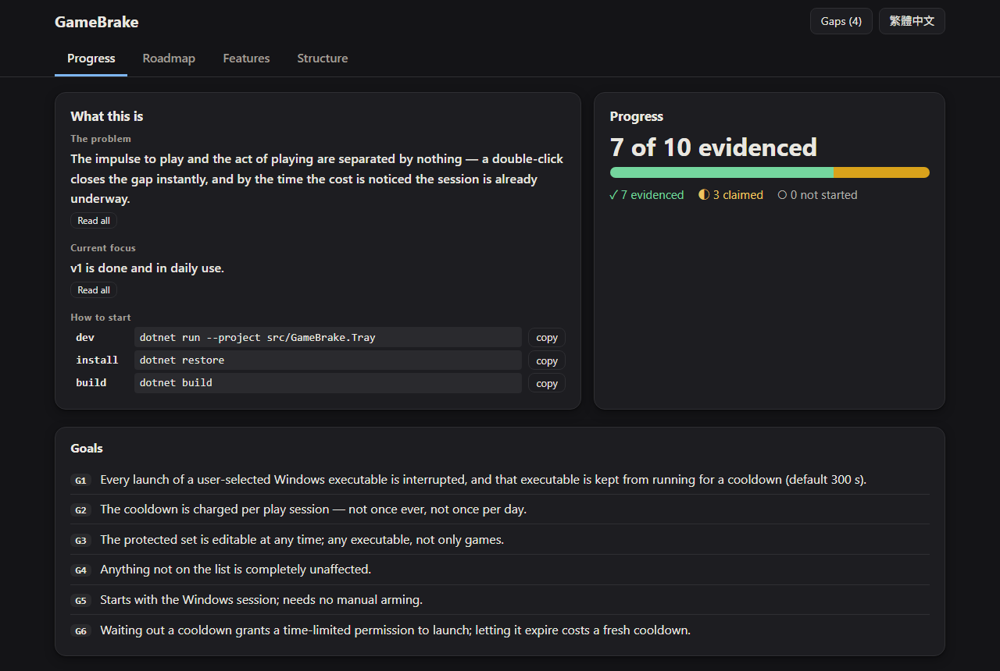

<!-- Hero -->
<div align="center">
  <h1>🔥 SparkForge</h1>
  <p><b>给 AI 编码 agent 用的工作流框架</b>：复制进新项目后，它让 agent 拥有会累积的记忆，以及判断证据是否成立的方法；它本身不带任何项目知识。</p>
  <p>
    
    
    
    
  </p>
  <p>🌏 简体中文 · <a href="./README.zh-TW.md">繁體中文</a> · <a href="./README.md">English</a></p>
</div>

<p align="center"></p>

## ✨ 功能

- **会累积的记忆**：`SPEC.md`、`METHOD.md`、`STATE.md` 和 `GOTCHAS.md` 每个 session 都会加载，agent 在状态一变化时就写下来，不用等人叫。
- **一个指令，所有工具**：Claude Code、Cursor、Copilot、Gemini CLI、Cline、Windsurf、Codex CLI、Amp 和 DeepSeek Harness 都从 `AGENTS.md` 开始。
- **规格门**：一个功能从问题、目标和验收标准开始，由人批准；涉及认证、支付、密钥或数据库迁移的改动不能跳过。
- **站得住的证据**：从真实事故提炼的规则，判断一次通过的测试到底证明了什么，以及如何把失败追到原因。
- **进度页**：一个命令就从规格、状态和 git 生成一页——带证据的验收标准、路线图、功能指南、组件结构和工作时间线，支持英文加一种语言。
- **会失败的检查**：`scripts/check.sh` 检查结构、stub、执行权限、README 各版本，以及 README 对仓库的描述是否属实。
- **从上游更新**：`scripts/update-kit.sh` 替换 `kit/`，并列出更新在 `kit/` 以外需要的东西。

## 🚀 安装

前提：git 和 bash。Windows 上就是 Git for Windows 自带的 Git Bash。

**方式一 · Git Bash、macOS 或 Linux**

```bash
# 复制整个模板。要用 "template/."，不能用 "template/*"，
# 否则 .claude/、.cursor/、.github/ 和 .gitattributes 会被悄悄漏掉
cp -R "/path/to/SparkForge/template/." "/path/to/my-project/"
cd "/path/to/my-project"
git init

# 在 stage 任何东西之前，把 AGENTS.md 第一行的 "# SparkForge"
# 换成你的项目名称

# 先 stage，再在 index 里设置执行权限：Windows 的工作目录
# 没有真正的权限位，chmod 做不到
git add -A
git add --chmod=+x -- 'scripts/*.sh' 'kit/scripts/*.sh'
git commit -m "Adopt SparkForge"
```

**方式二 · 从 PowerShell**

<details>
<summary>想留在 PowerShell 里时用这个</summary>

在 PowerShell 里输入 `bash`，会找到 `C:\Windows\System32\bash.exe`，那是 WSL 的启动器；没有安装发行版时，它会报 `execvpe(/bin/bash) failed`。改用 Git 自带的 bash：

```powershell
# Git 装在哪里；不一定在 C: 盘
(Get-Command git).Source

# & 不能省：没有它，PowerShell 只会把引号里的路径打印出来
& "C:\Program Files\Git\bin\bash.exe" scripts/check.sh
```

</details>

**验证**

```bash
git ls-files -s -- 'scripts/*.sh' 'kit/scripts/*.sh'
bash scripts/check.sh
```

第一个命令的每一行都以 `100755` 开头，第二个命令最后打印 `check.sh: all checks passed`。

## 🕹️ 使用

### 第一个 session

打开你的 agent，让它**运行 bootstrap**；它不会自己开始。bootstrap 只运行一次，它会：

1. 把脚本连同执行权限 stage 进 index；
2. 询问 `MODE` 和 `TEAM`，写进 `AGENTS.md`；
3. 逐项填好 Environment facts，项目确实没有的命令就写 `none`；
4. 按 `MODE` 选择的深度运行规格门；
5. 把结果写进 `SPEC.md`，并让 `STATE.md` 指向第一个要做的部分；
6. **让 `METHOD.md` 保持空白**：规则要从项目真正踩到的坑里得来，不能预先猜。

### 之后的每一天

记忆会自己加载：入口文件导入 `AGENTS.md`，`AGENTS.md` 再导入四个记忆文件。agent 按情境使用 skill：

| 当你正在… | Skill | 一句话 |
| --- | --- | --- |
| 🚪 准备做一个功能 | `kit/skills/spec-gate.md` | 把需求重述成问题，只问会卡住的问题，写出目标、非目标、验收标准和契约，然后停下来等批准。 |
| 🧪 看着一次全绿的测试 | `kit/skills/verification.md` | 第一次就通过的测试是未验证的。故意弄坏代码，看该失败的测试有没有失败。 |
| 🔍 追查一个失败 | `kit/skills/diagnosis.md` | 间歇性失败有发生率，跑一次量不出来。 |
| 👥 和别人一起工作 | `kit/skills/team-contract.md` | 只约定一次契约，以及谁负责哪些目录。 |
| 💾 写记忆 | `kit/skills/memory-update.md` | 状态一变化就写；写之前先重读整个文件。 |
| 📝 写 README | `kit/skills/readme.md` | 就是这一页的格式，三个语言版本，结构和命令都会被检查。 |

### 这些情况下规格门不能省

不管 `MODE` 是什么，任何涉及 🔐 认证、🛡️ 授权、💳 支付、🔑 密钥、🗄️ 数据库迁移，或 🌐 不止一个服务的改动，都要过规格门。

### 记忆怎么运作

- **边做边写**：做完一步、做了决定、踩到坑——马上写下，因为 session 随时可能中断。
- **`METHOD.md` 累积**：规则在原处修正，不另外加一条互相矛盾的。
- **`STATE.md` 整份替换**：不再成立的内容直接删掉；历史由 git 保存。
- **你的改动让某个说法变错，就在同一步修正**。

### 进度页

```bash
bash scripts/progress.sh
```

它读取 `SPEC.md`、`STATE.md` 和 git，不存储任何东西，所以不会过时。在 `AGENTS.md` 设置 `TRANSLATION` 可以加一种语言：你让 agent 打开页面时它会先写好翻译，剩下的可以用浏览器机器翻译。

### 更新

```bash
bash scripts/update-kit.sh
bash scripts/check.sh
```

第一个命令替换 `kit/`，并列出更新在 `kit/` 以外新需要的东西；第二个确认结果。属于 SparkForge 而不是你项目的发现，写在你 `STATE.md` 的 `Upstream` 下面，旁边 SparkForge checkout 里的 `scripts/collect-upstream.sh` 会读到它。

## 🚪 一个指令，所有工具

自己找不到 `AGENTS.md` 的工具，在它一定会读的路径放一个小文件，里面只说该去哪里。⚠️ 绝不要在这些文件里写指示：两个工具读到两套规则，正是这个安排要防止的。不用某个工具？删掉它的入口文件就好。

| 工具 | 它的文件 | 怎么加载 |
| --- | --- | --- |
| 🤖 Claude Code | `CLAUDE.md` | `@AGENTS.md`，真正的导入 |
| ✏️ Cursor | `.cursor/rules/sparkforge.mdc` | `alwaysApply: true` |
| 🐙 GitHub Copilot | `.github/copilot-instructions.md` | 它一定会读的路径 |
| 💠 Gemini CLI | `GEMINI.md` | 它一定会读的路径 |
| 🧵 Cline | `.clinerules` | 它一定会读的路径 |
| 🏄 Windsurf | `.windsurfrules` | 它一定会读的路径 |
| 🌊 Codex CLI、Amp、DeepSeek Harness | `AGENTS.md` 本身 | 原生读取 |

## 🧰 项目会得到什么

| 文件 | 用途 |
| --- | --- |
| ⚙️ `AGENTS.md` | 入口，也是唯一负责分派的文件：声明、Environment facts、硬性规则、skill 表。 |
| 📐 `SPEC.md` | 已批准的契约。只能经过规格门修改。 |
| 🧠 `METHOD.md` | 这个项目挣来的规则。一开始是空的。 |
| 📌 `STATE.md` | 工作进行到哪。整份替换，从不追加。 |
| 🐛 `GOTCHAS.md` | 绑定版本的陷阱，每条都有日期。 |
| 📚 `kit/` | 框架本身。在项目里绝不修改；更新时会被覆盖。 |
| 🪝 `.claude/` | stub，每个都指向 `kit/`。 |
| ✅ `scripts/` | `check.sh`、`update-kit.sh` 和 `progress.sh` 的 stub，交给 `kit/scripts/` 执行。 |

## 🌡️ 成熟度

如实说明，因为这个框架自己的方法要求这样做。它已安装在五个项目：四个在 Windows，一个在 Linux 容器。其中一个桌面工具已经完成所有验收标准，每天都在用。

| 组件 | 状况 |
| --- | --- |
| 🧪 `verification.md`、🔍 `diagnosis.md`、💾 `memory-update.md` | ✅ 从真实事故提炼；好几条规则带着两三个项目的事故记录。 |
| ✅ `check.sh`、🔄 `update-kit.sh` | ✅ 在每个项目都运行过；`update-kit.sh` 曾在运行中替换自己而不留痕迹。 |
| 🥾 `bootstrap.md`、🚪 `spec-gate.md` | 🟡 按规格写成，在每个项目都运行过；规格门每次都是 bootstrap 的第四步，从没自己触发过。 |
| 📊 进度页 | 🟡 每个项目都装了；只在一个项目看到实际使用。 |
| 📝 `readme.md` | 🟡 新的。这一页是它的第一次使用。 |
| 🚪 各工具的入口文件 | 🟡 Claude Code 的已观察到有效；其他的是请 agent 打开 `AGENTS.md`，都还没实际打开过。 |
| 👥 `team-contract.md`、🕵️ `evidence-reviewer.md`、🎚️ T0/T1/T2 分级 | ⚠️ 从未使用过。 |

## 🛠️ 开发与测试

这个仓库存放框架本身；`template/` 是项目会得到的东西。任何改动之后：

```bash
bash scripts/check-repo.sh
```

选择下一步做什么之前，先读旁边各项目记录下来的东西：

```bash
bash scripts/collect-upstream.sh
```

## 📦 项目结构

```text
template/
template/kit/skills/
template/kit/scripts/
template/kit/readme-skeleton.md
scripts/check-repo.sh
scripts/collect-upstream.sh
source/METHOD.md
METHOD.md
STATE.md
docs/progress-page.png
```

- `template/`：项目复制进去的内容，它的内容会成为项目的根目录；
- `template/kit/skills/`：正式的 skill，一个文件一个；
- `template/kit/scripts/`：检查器、更新器和进度页；
- `template/kit/readme-skeleton.md`：这一页的格式，供复制；
- `scripts/check-repo.sh`：先对 `template/` 运行附带的检查器，再运行只属于这个仓库的检查；
- `scripts/collect-upstream.sh`：列出这个 checkout 旁边的每个项目、它的 `kit/` 是否最新，以及它的 `Upstream`；
- `source/METHOD.md`：这些规则转化前的方法论原文；
- `METHOD.md`、`STATE.md`：SparkForge 自己的记忆，和 `template/` 里的空壳分开；
- `docs/progress-page.png`：上面那张截图。

## ⚠️ 兼容性与限制

- 在 Windows 上写成，在 Linux 容器里走过一遍；从没在 macOS 上运行过，虽然脚本是照它的 bash 3.2 和 BSD awk 写的。
- 没有任务跟踪、看板或任务卡。
- 不扫描已有的代码：SparkForge 是给从第一个 commit 就采用它的项目。
- 没有针对非软件工作的设计，没有 UI 设计系统，没有设计稿关卡。
- 不收任何需要整个团队都采用才有价值的模块。

## ❓ 常见问题

| 症状 | 怎么做 |
| --- | --- |
| PowerShell 里出现 `execvpe(/bin/bash) failed` | 那是 WSL 的启动器，不是 Git Bash；改用 Git Bash，或上面的方式二 |
| `check.sh` 说某个 shell 脚本在 index 里没有执行权限 | 对它点名的文件运行 `git add --chmod=+x`；Windows 上 `chmod` 设置不了 |
| 复制后少了 `.claude/` 或 `.github/` | 复制时用了 `template/*`；重新复制 `template/.` |
| `update-kit.sh` 拉不到上游 | 它从不等待登录；改传它打印的 SSH URL |
| 刚更新完 `check.sh` 就失败 | 更新需要 `kit/` 以外的东西；照每一行失败信息的提示补上 |
| 进度页全是英文，带着 EN 标记 | 让 agent 打开页面，或按页面上的翻译按钮 |

## 📄 许可证

MIT，见 [LICENSE](LICENSE)。
